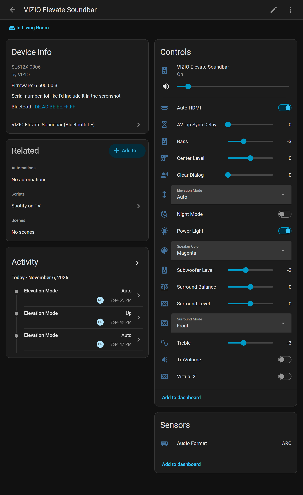

# VIZIO Elevate BLE Home Assistant Integration

A local, push-based Home Assistant custom component for the **VIZIO Elevate Soundbar** (tested with [VIZIO Elevate SE SL512X-0806](https://www.vizio.com/en/sound-bar/sb/SL512X-0806)) over Bluetooth Low Energy (BLE).



---

## Features

* **Media Player (`media_player.py`)**:
  * Volume control with step walking to arbitrary targets
  * Audio mute toggle
  * Input source selection (`Bluetooth`, `HDMI-eARC`)
  * EQ mode selection (`Movie`, `Music`, `Game`, `Direct`)
* **Real-time Audio Format Sensor (`sensor.py`)**:
  * Live decoded format string directly from hardware (e.g. `Dolby Atmos`, `Dolby Audio - Dolby Digital Plus`, `Stereo PCM`)
* **Device Registry Info (`entity.py`)**:
  * Automatically populates hardware model (`0x004a`), serial number (`0x004c`), and firmware version (`0x004e`)
* **Elevation & Audio Mode Selects (`select.py`)**:
  * **Elevation Mode**: `Auto`, `Up`, `Wide` (rotates the physical elevation speakers)
  * **Surround Mode**: `Off`, `On`, `Dual`, `Front`
  * **Speaker LED Color**: `Off`, `Rainbow`, `Light Blue`, `Yellow`, `Purple`, `White`, `Cyan`, `Magenta`
* **Audio Processing & Feature Toggles (`switch.py`)**:
  * **DTS Virtual:X** toggle
  * **DTS TruVolume** volume leveling
  * **Night Mode** dynamic range compression
  * **Power Indicator Light** front LED
  * **Auto HDMI** input switching
* **Level Sliders (`number.py`)**:
  * **Bass** (`-10` to `+10`)
  * **Treble** (`-10` to `+10`)
  * **Center Channel** (`-10` to `+10`)
  * **Subwoofer Level** (`-10` to `+10`)
  * **Surround Level** (`-10` to `+10`)
  * **Surround Balance** (`-10` to `+10`)
  * **Clear Dialog** (`0` to `10`)
  * **AV Lip Sync Delay** (`0` to `8`)

---

## Prerequisites (Crucial First Steps)

The soundbar requires BLE Security Manager Protocol (SMP) pairing and link encryption. Because headless Linux/BlueZ does not run an interactive pairing agent for untrusted peripherals, **you must pair and trust the soundbar manually at the OS level before setting it up in Home Assistant.**

### 1. Close Phone Apps
The soundbar only supports **one concurrent BLE client**. Disconnect your phone from the soundbar and force-close the VIZIO mobile app.

### 2. Pair and Trust in `bluetoothctl`
Open a terminal on your Home Assistant host machine (or SSH into HAOS):

```bash
bluetoothctl
```

Inside the `bluetoothctl` shell:

```text
[bluetooth]# scan on
# Wait for "[VIZIO Mobile App]" to appear with its MAC address (e.g. AA:BB:CC:DD:EE:FF)
[bluetooth]# pair AA:BB:CC:DD:EE:FF
[bluetooth]# trust AA:BB:CC:DD:EE:FF
[bluetooth]# quit
```

### 3. Reboot Home Assistant Host
To ensure BlueZ permanently saves the Long Term Key (LTK) and marks the trust flags without any lingering transient D-Bus sessions, **reboot the entire host machine** (e.g. via `sudo reboot` or *Settings -> System -> Hardware -> Reboot Host* in Home Assistant).

---

## Installation

1. Copy the `custom_components/vizio_elevate_ble` directory into your Home Assistant config folder:
   ```text
   /config/custom_components/vizio_elevate_ble/
   ```
2. Restart Home Assistant.
3. The soundbar will either be auto-discovered as a Bluetooth device or you can manually add it:
   * Go to **Settings** $\rightarrow$ **Devices & Services** $\rightarrow$ **Add Integration**
   * Search for **VIZIO Elevate Soundbar (Bluetooth LE)**
   * Select your soundbar from the list and confirm.

---

## How It Works

### Standalone Protocol Client (`client.py`)
The underlying client has zero Home Assistant dependencies and uses `bleak` + `bleak_retry_connector`. It handles:

1. **Dynamic GATT Handle Resolution**:
   Different OS Bluetooth stacks (BlueZ, Windows WinRT, macOS CoreBluetooth) report ATT handles with differing offsets relative to value handles. The client scores characteristic handles against known signatures (`score(offset)`) to align with the soundbar's internal GATT table.

2. **Challenge/Response Authentication**:
   * Subscribes to `0x00bf` (Auth Status notification).
   * Reads `0x0056` (Device Tag).
   * Writes the static Client ID (`1:f4c46a1e-4e22-`) to `0x00c2`.
   * Reads a 4-character ASCII challenge from `0x00c2`.
   * Writes `<challenge>:<AUTH_SUFFIX>` to `0x00c5`.
   * Reads the resulting 8-character session token from `0x00c5`.
   * All subsequent control writes prepend `<token>:` to the payload.

3. **Step-Walking Volume**:
   The soundbar firmware rejects jumps larger than 1 step per write (writing `15` when currently at `10` only increments to `11`). A background async task walks toward the requested volume target 1 step at a time, awaiting notification confirmation on each step.

4. **Live GATT Notifications**:
   Subscribes to all notification-capable characteristics once authenticated. When settings are changed using the physical infrared/Bluetooth remote, updates are pushed directly to Home Assistant in real time.

---

## Integration Options

Click **Configure** on the VIZIO Elevate card under **Settings -> Devices & Services**:

* **Maximum volume limit (1-100)**:
  Device-level volume guard rail (default: `100`). The Home Assistant volume slider scales to this maximum limit (e.g. setting `40` means `100%` on the slider corresponds to level 40 on the soundbar, and `50%` maps to level 20). The exact soundbar level is also reported in the entity's attributes.
* **Disconnect when idle**:
  * **Off (Default, Recommended)**: Home Assistant keeps the BLE connection open continuously. Volume changes and physical remote presses update instantly with zero latency. *(Locks out the official VIZIO mobile phone app while connected).*
  * **On**: Home Assistant drops the BLE link after 2 minutes of inactivity, freeing the soundbar for the mobile app. Sending commands from Home Assistant will incur a ~1.5s reconnect and authentication handshake.

---

## Standalone Diagnostics (`tools/probe.py`)

You can verify the client and read all settings from any machine with Python and Bleak before involving Home Assistant:

```bash
pip install bleak bleak-retry-connector
python tools/probe.py
```
